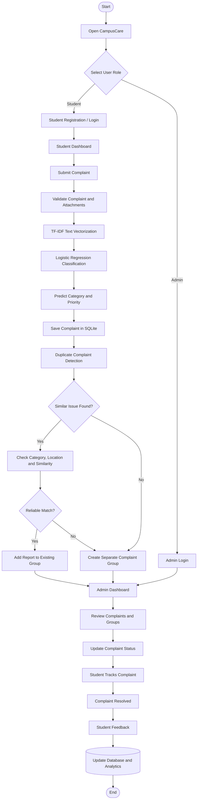
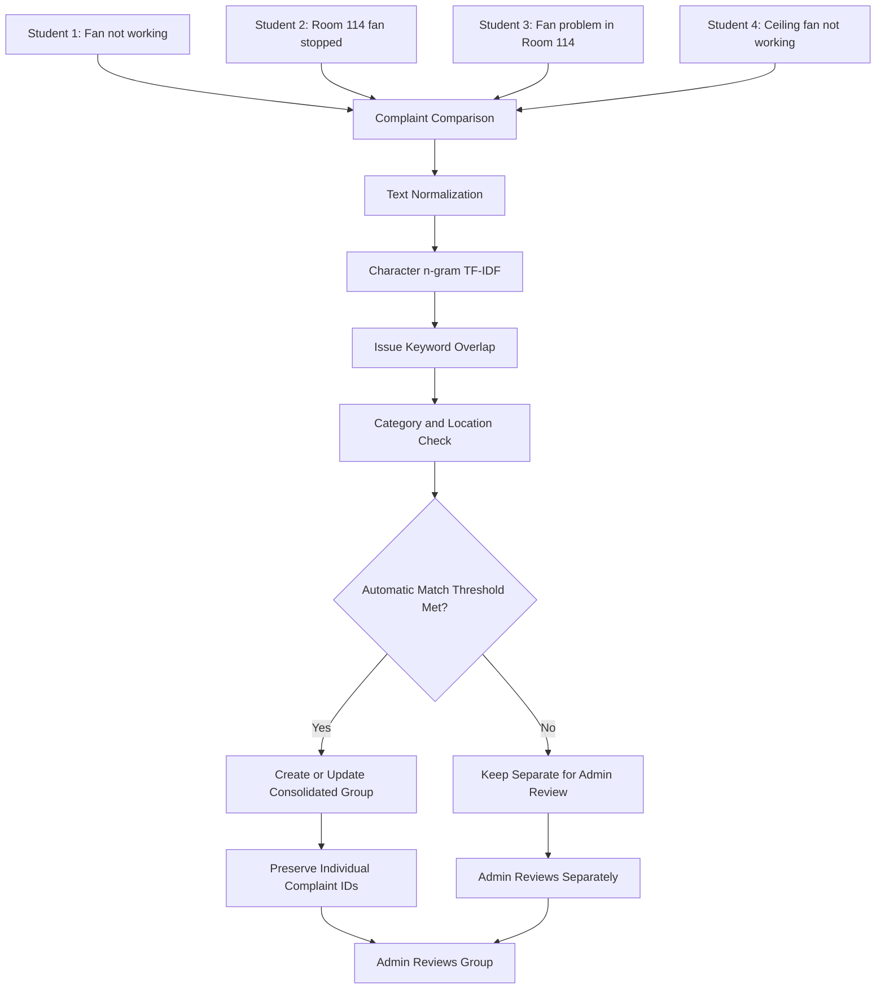
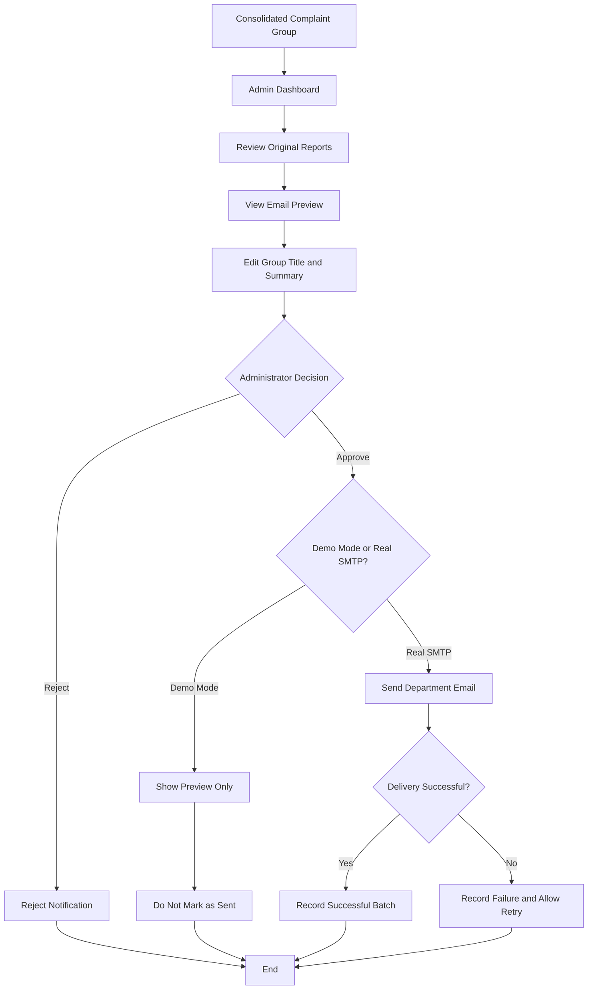

# CampusCare Advanced
## AI-Based College Complaint Classification and Management System

CampusCare is a web-based college complaint management system developed using **Python, Flask, SQLite, and Machine Learning**. It provides a centralized platform where students can register complaints, track their status, receive updates, and provide feedback after resolution.

The system uses **TF-IDF and Logistic Regression** to classify complaints into relevant categories. It also identifies potentially duplicate complaints, groups related reports, and allows administrators to review and approve consolidated department notifications.

---

## 1. Problem Statement

In many colleges, complaints related to academics, infrastructure, sanitation, hostels, transportation, and other facilities are managed through informal communication or manual processes.

This can lead to:

- Delayed complaint resolution.
- Difficulty tracking complaint status.
- Repeated complaints about the same issue.
- Lack of centralized complaint records.
- Difficulty identifying frequently reported problems.
- Inefficient communication between students and departments.

**CampusCare addresses these challenges** through an AI-assisted complaint classification and management platform.

---

## 2. Project Objectives

- Provide a centralized complaint submission platform.
- Maintain separate student and administrator accounts.
- Automatically classify complaints using machine learning.
- Allow students to track their complaints privately.
- Identify and group similar complaints.
- Generate consolidated notifications for departments.
- Require administrator approval before sending notifications.
- Provide complaint analytics, search, filters, and CSV reports.
- Collect student feedback after complaint resolution.
- Support English and Hindi interfaces.

---

## 3. Technology Stack

| Component | Technology |
|---|---|
| Programming Language | Python |
| Backend Framework | Flask |
| Database | SQLite |
| Machine Learning | Scikit-learn |
| Text Vectorization | TF-IDF |
| Classification Algorithm | Logistic Regression |
| Duplicate Detection | Character n-gram TF-IDF and keyword overlap |
| Frontend | HTML, CSS, JavaScript |
| Charts | Chart.js |
| Authentication | Flask Sessions and Werkzeug Password Hashing |
| Data Export | CSV |

---

## 4. System Architecture and Working Flow

The following diagram explains the overall working of CampusCare, from student registration to complaint resolution.



### Working Explanation

**Step 1 – Student Registration and Login**

Students create an account using their name, college email, enrollment number, department, academic year, and password. Passwords are stored as salted Werkzeug hashes.

**Step 2 – Complaint Submission**

Authenticated students submit complaints through the complaint form. They can also attach up to three supported images.

**Step 3 – AI-Based Classification**

The complaint text is processed using TF-IDF vectorization and classified using a Logistic Regression model.

The predicted category is selected from the following nine categories:

1. Academics
2. Infrastructure
3. IT / Technical
4. Sanitation
5. Canteen
6. Hostel
7. Transportation
8. Administration
9. Other

If the maximum predicted class probability is below 0.16, the complaint is assigned to Other.

**Step 4 – Priority Estimation**

The system estimates complaint priority using predefined keyword-based rules.

**Step 5 – Duplicate Complaint Detection**

The system compares complaint text using character n-gram TF-IDF similarity and issue-keyword overlap. It also checks category and extracted location before automatically grouping complaints.

**Step 6 – Complaint Storage**

Original complaints are stored individually in SQLite with unique complaint IDs. Each student can independently track their own complaints.

**Step 7 – Administrator Management**

Administrators review complaints, update statuses, manage consolidated groups, view analytics, and export reports.

**Step 8 – Feedback and Resolution**

After resolution, students can submit a rating from 1 to 5 and an optional comment.

---

## 5. Duplicate Complaint Detection and Grouping

One of the important features of CampusCare is its ability to identify potentially repeated complaints.

### Example Scenario

Suppose four students report that the ceiling fan in Room 114 is not working.

Instead of treating these reports as completely unrelated issues, CampusCare can identify their similarity and create a consolidated complaint group.



### Duplicate Detection Rules

- Default similarity threshold: `0.72`.
- Category must match.
- Extracted location must match.
- Text similarity and issue-keyword overlap are considered.
- Reports without a location remain separate.
- Uncertain matches are not automatically grouped.
- Every original complaint remains individually stored and trackable.

The threshold can be configured through:

```cmd
set CAMPUSCARE_DUPLICATE_SIMILARITY_THRESHOLD=0.78
```

---

## 6. Consolidated Department Notification Workflow

CampusCare does not automatically send department emails when students submit complaints.

Instead, it follows an administrator-controlled approval process.



### Notification Features

- Consolidated complaint count.
- Complaint category and location.
- Original complaint IDs.
- Complaint summary.
- HTML and plain-text email preview.
- Editable group title and summary.
- Reject and Approve & Send actions.
- Admin-only approval routes.
- Batch-level notification records.
- Retry handling for SMTP failures.
- Protection against duplicate successful sends.

**Important:** Department emails use temporary `example.com` addresses. Therefore, the project operates in Demo Mode and does not actually send emails. Real email delivery requires verified department addresses and SMTP configuration.

---

## 7. Main Features

### Student Module

- Student registration and login.
- Secure password hashing.
- Private complaint submission.
- Complaint image attachments.
- Personal complaint dashboard.
- Complaint status tracking.
- Live status timeline.
- Student profile management.
- Feedback after resolution.
- English and Hindi interface.
- Local campus FAQ/status assistant.

### Administrator Module

- Separate admin authentication.
- Centralized complaint dashboard.
- Complaint category and priority management.
- Complaint status updates.
- Duplicate complaint grouping.
- Consolidated notification approval.
- Email preview and management.
- Analytics charts.
- Search and advanced filters.
- CSV report export.
- Student feedback analysis.

### AI and Automation Features

- TF-IDF text vectorization.
- Logistic Regression classification.
- Confidence-based category fallback.
- Keyword-based priority estimation.
- Duplicate complaint detection.
- Automatic complaint escalation.
- English and Hindi support.
- Local FAQ/status assistant.

---

## 8. Complaint Escalation System

CampusCare checks overdue complaints and increases their priority when they cross configured time limits.

| Complaint Status | Escalation Time |
|---|---:|
| Pending | 48 hours |
| In Progress | 72 hours |

When a complaint is escalated:

- Its priority is raised to High.
- An escalation event is added to its timeline.
- The student and administrator can see the updated complaint history.

Configuration:

```cmd
set CAMPUSCARE_ESCALATE_PENDING_HOURS=48
set CAMPUSCARE_ESCALATE_PROGRESS_HOURS=72
```

For scheduled checks, Windows Task Scheduler can run:

```cmd
python -m flask --app app escalate-complaints
```

Example schedule: every 15 minutes.

---

## 9. Database and Data Management

CampusCare uses SQLite for storing application data.

The application maintains records related to:

- Student accounts.
- Complaint information.
- Complaint categories and priorities.
- Complaint status history.
- Complaint attachments.
- Consolidated complaint groups.
- Notification batches.
- Student feedback.
- Complaint event timelines.

The application includes additive database migrations to support new fields and tables while preserving existing complaint records and IDs.

Before the current schema migration, the application creates a timestamped database backup.

**Backup recommendation:** Back up both `complaints.db` and the `uploads/` directory.

---

## 10. Project Structure

```text
CampusCare_Advanced/
│
├── app.py
├── classifier.py
├── localization.py
├── requirements.txt
├── README.md
├── .gitignore
│
├── complaints.db
│
├── static/
│   └── style.css
│
├── templates/
│   ├── about.html
│   ├── admin.html
│   ├── base.html
│   ├── consolidated_email_preview.html
│   ├── consolidated_group.html
│   ├── index.html
│   ├── landing.html
│   ├── login.html
│   ├── student_complaint.html
│   ├── student_dashboard.html
│   ├── student_login.html
│   ├── student_profile.html
│   ├── student_register.html
│   ├── submitted.html
│   └── track.html
│
├── uploads/
│
└── tests/
    ├── test_app.py
    └── test_classifier.py
```

*Note: `complaints.db`, uploaded images, and the virtual environment are runtime files and may not be included in the GitHub repository.*

---

## 11. Installation and Execution

### Requirements

- Python 3.x
- pip
- Windows CMD or PowerShell
- Git (optional)

### Step 1 – Download the Project

Clone the GitHub repository:

```cmd
git clone https://github.com/FRANCIUM444/ai-based-complaint-classifier.git
```

Alternatively, download the repository as a ZIP file and extract it.

### Step 2 – Open the Project Folder

```cmd
cd ai-based-complaint-classifier
```

### Step 3 – Create a Virtual Environment (Recommended)

```cmd
python -m venv venv
```

Activate it:

```cmd
venv\Scripts\activate
```

### Step 4 – Install Dependencies

```cmd
python -m pip install -r requirements.txt
```

### Step 5 – Start the Flask Application

```cmd
python app.py
```

### Step 6 – Open CampusCare

Open your browser and visit:

http://127.0.0.1:5000

---

## 12. Demo Administrator Account

For local demonstration:

| Field | Value |
|---|---|
| Username | `admin` |
| Password | `admin123` |

These credentials are for demonstration only.

Before deployment, configure strong administrator credentials and a stable secret key.

### Windows CMD Configuration

```cmd
set ADMIN_USERNAME=youradmin
set ADMIN_PASSWORD=use-a-strong-password
set SECRET_KEY=replace-with-a-long-random-secret
set SESSION_COOKIE_SECURE=true
python app.py
```

`SESSION_COOKIE_SECURE=true` requires HTTPS. Keep the secret key and administrator credentials private.

---

## 13. Testing

CampusCare includes application and classifier regression tests.

Run the test suite using:

```cmd
python -m unittest discover -s tests -v
```

The classifier includes 186 built-in labeled training examples and a curated 45-example holdout set.

The holdout set is intended for regression testing and does not replace evaluation on representative, independently labeled college complaints.

---

## 14. Security Measures

The project includes the following security mechanisms:

- Werkzeug salted password hashing.
- Student and administrator role separation.
- Authentication-protected complaint operations.
- Student-specific complaint access.
- CSRF protection for state-changing requests.
- Login attempt rate limiting.
- Restricted access to complaint attachments.
- Administrator-only notification approval.
- Environment-based secret and SMTP configuration.

For production deployment, use HTTPS, strong credentials, a stable secret key, and secure backup procedures.

---

## 15. Limitations

- The classifier is trained on a relatively small built-in dataset.
- Model confidence is approximate and does not guarantee correct classification.
- Priority is estimated using keyword rules.
- Hindi classification uses a limited local phrase map and may be less accurate for uncommon wording.
- Chart.js is loaded from a CDN, so internet access is required for dashboard charts.
- Department email delivery is disabled in Demo Mode.
- Automatic duplicate grouping depends on matching category, location, and text similarity.
- Escalation checks may require Windows Task Scheduler when the application is idle.

---

## 16. Future Scope

Possible future improvements include:

- Training with a larger real-world college complaint dataset.
- Improving multilingual text classification.
- Adding more advanced semantic duplicate detection.
- Adding department-wise performance reports.
- Introducing mobile application support.
- Adding real-time notifications.
- Integrating verified institutional email services.
- Deploying the application on a secure cloud platform.

---

## 17. Conclusion

CampusCare Advanced provides a centralized and AI-assisted approach to managing college complaints. By combining machine learning classification, duplicate complaint grouping, secure student accounts, administrator-controlled department notifications, complaint tracking, analytics, and student feedback, the system aims to improve transparency and efficiency in college complaint management.

The project demonstrates how Python, Flask, SQLite, and machine learning can be combined to build a practical academic complaint management solution.

---

## 18. Repository

**GitHub:** https://github.com/FRANCIUM444/ai-based-complaint-classifier

**Project Name:** CampusCare Advanced – AI-Based College Complaint Classification and Management System

**Project Type:** College Mini Project

**Domain:** Machine Learning, Web Development, Natural Language Processing, and Database Management
